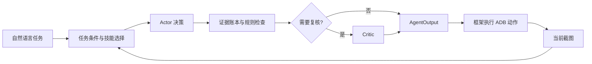

# Agent GUI

基于多模态模型与 ADB 的安卓 GUI Agent：接收自然语言任务，通过“截图观察 → 决策 → 设备操作 → 下一步截图核验”的闭环推进任务。

当前版本在已有执行框架内增加任务条件解析、时序证据账本、按需静态技能、动作校验与条件触发的 Critic。适合研究安卓界面任务执行、跨 App 信息搬运，以及模型动作的证据核验。

## 核心能力

- **任务条件解析**：提取应用、目标数量、评分条件和初始完成条件；例如“超过 4.8”与“不低于 4.8”分别判断。
- **证据账本**：分别管理页面事实与跨页面任务产物，维护动作历史和待核验操作。发出点击不会直接记为完成。
- **静态技能路由**：从人工维护的 JSON 技能库选择相关操作经验，根据应用和恢复状态过滤。
- **结构化动作协议**：校验 JSON 决策，兼容旧 Action 文本格式；解析失败时尝试修复，再返回合法 `WAIT`。
- **规则与 Critic**：检查动作参数、任务约束和副作用范围；完成请求必须经过证据门禁及独立上下文的 Critic。
- **调用预算**：限制模型调用次数、任务 Token 和 Critic 次数，汇总重试、修复与复核的 usage。

Actor 与 Critic 调用同一个基类模型接口，使用不同消息上下文；项目没有自动技能学习或在线自进化机制。

## 执行流程



设备截图和 ADB 执行由原框架负责。Agent 用下一次输入的截图核验上一动作；截图发生变化本身不代表任务成功。

## 目录

```text
agent.py                       # Agent 入口、预算、重试与 Critic
agent_base.py                  # 输入输出协议、模型接口与 usage
device_controller.py           # ADB 截图、中文输入与设备动作
run_tests.py                   # 真机任务批量执行入口
test_runner.py                 # 执行循环、轨迹记录与输出
requirements.txt               # 原框架依赖
tasks/tasks.json               # 10 个示例任务
utils/
  gui_agent/                   # 任务、观察、账本、解析、技能与规则
  gui_agent_skills.json         # 人工维护的静态技能
  image_utils.py               # 图像辅助处理
  visualize.py                 # 轨迹汇总图
tests/test_gui_agent.py         # 离线回归测试
docs/
  gui-agent-redesign.md         # 重设计方案与实施边界
  gui-agent-implementation.md   # 实现细节与已知限制
  repository-content.md        # 仓库文件收录说明
```

## 安装与离线验证

本地已在 Python 3.13.9 下运行离线测试。其他 Python 版本的兼容性尚未逐一验证。

```powershell
git clone https://github.com/zry2002240814-collab/agent_gui.git
cd agent_gui
python -m venv .venv
.\.venv\Scripts\python.exe -m pip install -r requirements.txt
.\.venv\Scripts\python.exe -m unittest discover -s tests -v
.\.venv\Scripts\python.exe run_tests.py --help
```

离线测试使用模拟模型响应与人工生成截图，无需 API Key 或安卓设备。当前 47 项回归测试通过，覆盖动作解析、证据有效期、数量与评分判断、待核验操作、完成门禁、预算、Token 汇总及固定框架文件校验。离线通过不代表真机任务成功率已经验证。

## 真机运行

1. 安装 Android Platform Tools，确保 `adb` 在 PATH 中；手机开启 USB 调试并授权电脑。
2. 使用 `adb devices` 检查设备连接；安装任务涉及的 App，并准备好对应账号状态。
3. 中文输入需要兼容 `com.android.adbkeyboard/.AdbIME` 的 ADB Keyboard。自行准备来源明确的安装包，执行 `adb install <安装包路径>` 和 `adb shell ime enable com.android.adbkeyboard/.AdbIME`；控制器连接时会尝试切换输入法。安装包未随仓库分发。
4. 在当前 PowerShell 会话设置模型 Key，再运行任务。

```powershell
$env:VLM_API_KEY = "<你的 API Key>"
.\.venv\Scripts\python.exe run_tests.py

# 多设备时指定序列号
.\.venv\Scripts\python.exe run_tests.py --serial <设备序列号>

# 自定义任务与断点续跑
.\.venv\Scripts\python.exe run_tests.py --tasks tasks/my_tasks.json --output output/my_run
.\.venv\Scripts\python.exe run_tests.py --tasks tasks/my_tasks.json --output output/my_run --resume
```

`agent_base.py` 固定模型服务地址与模型 ID，Key 仅从 `VLM_API_KEY` 环境变量读取。运行前核对该模型端点是否对你的账号可用；当前框架不通过 CLI 参数切换模型，也不会自动读取 `.env` 文件。

任务 JSON 为数组，每项包含 `id`、`instruction`、`app` 和 `max_steps`。例如：

```json
[
  {
    "id": "music_demo",
    "instruction": "在QQ音乐搜索光年之外并播放邓紫棋演唱的版本",
    "app": "QQ音乐",
    "max_steps": 30
  }
]
```

原示例包含评论发布、酒店预订和依赖当前位置的任务，日期也需要按实际情况调整；批量执行前应按自己的任务范围筛选。默认规则不允许支付、真实下单、删除和敏感授权，明确要求发布评论的任务会启用对应发布权限。

结果默认保存在 `output/`，包含步骤截图、每题 `data.json`、`summary.png`、`run_metadata.json` 与日志。执行器记录的完成标记不能代替独立的任务正确性评估。入口末尾提示的 `generate_html.py` 不在当前项目中，现有输出可直接用于轨迹复核。

## Agent 参数

集成代码可通过 `Agent(config)` 调整内部预算；现有 CLI 默认创建 `Agent()`。

```python
from agent import Agent

agent = Agent({
    "retry_count": 3,
    "history_window": 12,
    "max_output_tokens": 2200,
    "max_api_calls": 240,
    "max_task_tokens": 250000,
    "max_critic_calls": 30,
    "allowed_side_effects": [],
})
```

支持 11 种框架动作：`CLICK`、`SCROLL`、`TYPE`、`OPEN`、`COMPLETE`、`LONG_PRESS`、`DOUBLE_CLICK`、`DRAG`、`BACK`、`HOME`、`WAIT`。坐标使用 0–1000 归一化值。

当前框架没有独立失败终止动作，也不向 Agent 回传 ADB 返回码。证据不足或预算耗尽时返回 `WAIT`，由外层步数限制结束。Critic 与 Actor 可能共享视觉判断错误；当前没有 UI Tree、独立 OCR 或真实模型成功率报告。

更多细节见[实现说明](docs/gui-agent-implementation.md)、[设计方案](docs/gui-agent-redesign.md)和[收录说明](docs/repository-content.md)。
