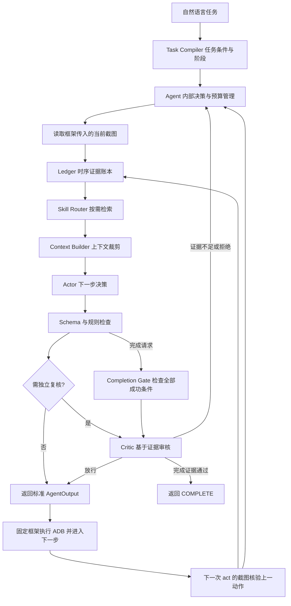

# GUI Agent 重设计方案 v2：固定框架内的 Agent 重构

状态：固定框架内的设计基线；已按此边界实现 Agent 重构，具体实现、配置与限制见 [实现说明](gui-agent-implementation.md)。

用户已明确的实施边界：取消原方案第 6 部分“离线技能迭代”；`agent_base.py`、`device_controller.py`、`requirements.txt`、`run_tests.py`、`test_runner.py` 不得修改。运行实现只修改 `agent.py`，并新增必要的辅助模块和静态 Skill 文件。不新增第三方依赖，不替换或 monkey patch 固定框架。

## 1. 定位与设计依据

将现有项目重设计为“基于时序证据与按需技能编排的安卓 GUI Agent”。第一版继续使用现有 PC + ADB + 安卓真机框架，改进自然语言任务执行与跨 App 信息搬运。执行与截图仍由原框架负责。

核心目标：模型负责理解与决策；Agent 内部负责状态、协议、授权边界和截图证据核验。普通步骤尽量一次主模型调用，额外复核只在必要节点发生。Agent 无法直接取得框架未回传的 ADB 执行结果，不将动作发出视为执行成功。

依据：

- GitHub `UAVLLMs/GUI-Agent`，核对提交 `97c3781035a770e5a3cb0ca4031ebd3e6b06bde0`：保留单步截图闭环、11 种设备动作、中文输入、轨迹保存、轻量停滞检测的思路。
- 《宋建辉-智能代理圆桌PPT》共 14 页：采用第 4–5 页的 Harness-first、第 7 页时序记忆、第 8 页按需 Skill、第 9 页规则与语义防护、第 10 页按需 Critic。第 11 页离线迭代不纳入实现。
- 本地工作区：`agent.py` 保存 assistant 文本历史，模型或格式失败返回空动作；尚无 GitHub 的 `finals_prompt.py`、`finals_decoder.py`。本地与远端不是同一 Agent 版本。

PPT 的指令性描述视为设计素材。PPT 第 12 页的成功率、耗时和成本是作者报告的结果，本方案不将其视为已经复现的基线，也不承诺新版本达到相同数字。

第一版范围：单设备、搜索播放、筛选收集、跨 App 搬运、路线查询。技能为人工维护的静态文件。自动支付、真实订单提交、批量删除、训练新模型、离线技能生成和在线自进化不纳入此次方案。

## 2. 需要解决的问题

| 当前问题 | 新版本应表现出的行为 |
|---|---|
| 模型回复历史混合观察、猜测、计划 | 每个事实可追溯到观察步骤和证据，计划不当成事实 |
| 长 Prompt 装入无关 App 经验 | 根据当前 App、阶段和故障选择少量技能 |
| 模型输出格式异常导致中止或假完成 | 明确记录解析失败，在预算内修复或重试 |
| Agent 得不到 ADB 执行结果 | 发出的动作保持待核验，下一步截图确认效果后才更新成功状态 |
| `COMPLETE` 直接成为完成标记 | 完成必须通过任务条件与证据检查 |
| 相似截图或重复动作触发固定滚动 | 将动作重复、画面变化与目标进展共同用于恢复 |
| App 固定映射和关键词路由脆弱 | 复用原映射，在 Agent 内规范别名；根据任务与截图确认的 App 选择技能 |

## 3. 总体架构



图中 Critic 的输出与待审核对象绑定：审核普通动作时只能返回动作审核结果；审核完成请求时只能返回完成审核结果，不能把普通动作放行转换为任务完成。

任务级采用少量阶段规划；界面级仍逐步观察和执行。开头制定子目标，遇到阻塞、跨 App 切换或证据冲突才调整计划。避免每步调用独立 Planner，也避免预先规定所有点击。

逻辑上有 Actor 和 Critic 两个模型角色；两者都在 `Agent` 内组织消息并调用继承的 `self._call_api()`，沿用固定模型和 API 配置。无需自建客户端，也不通过覆盖基类配置更换模型。

## 4. 核心模块

### 4.1 Task Compiler：先定义什么叫完成

输入用户指令，输出内部 `TaskSpec`：原始指令、指定或候选 App、约束、阶段目标、成功条件、允许的副作用和 Agent 内部预算。优先将任务解析与首次主模型决策合并，减少额外调用。任务最大步数仍由原执行器控制，不能假设它会传给 Agent。

示例：“在 QQ 音乐搜索光年之外并播放邓紫棋演唱的版本”。成功条件至少包含应用匹配、歌曲匹配、歌手匹配，以及界面存在实际播放状态的证据。仅出现歌曲搜索结果不算成功；仅点击播放按钮也不算成功。

任务约束不得在脱困时静默放宽。例如指定歌手无可播放版本，内部记录受限，而不是换成其他歌手后宣布完成。原框架没有交互式澄清接口；必要参数缺失时记录缺项与限制，不能假设新增询问通道。

### 4.2 Observer：仅处理框架提供的截图

每次 `act()` 将 `current_image` 与 `step_count` 转成内部 `Observation`：步骤、截图 ID、屏幕尺寸、画面指纹、模型观察摘要和 App 判断。App 来源区分任务指定、最近 OPEN 的预期目标与截图视觉确认，不能把预期目标直接当成实际前台 App。

本次不增加 UI Tree、独立 OCR、设备查询和主动截图通路。图像处理使用已有 Pillow，文字与控件识别由现有多模态模型完成。

画面变化通过相邻 `act()` 的截图判断，需要等待时返回标准 WAIT，让框架进入下一步。不能以“画面完全静止”为操作前提，也不能把像素变化直接等同于任务进展。动作引用当前步骤截图；返回动作后的即时界面变化无法在本次调用内监控。

### 4.3 Ledger：证据账本与工作记忆分离

维护两层数据：

1. 任务内事件：观察、动作提议、守卫决定、已返回动作、截图核验结果、事实更新；全部带步骤和证据引用。未收到执行反馈的动作不得记录为 ADB 成功。
2. 当前状态视图：任务阶段、下一目标、有效事实、跨页面产物、待处理条目、阻塞点。

事实建议字段：`fact_id`、`key`、`value`、`source_observation_id`、`source_step`、`app_name`、`scope`、`status`、`verification_method`、`supersedes`。

`status` 区分 proposed / confirmed / superseded / contradicted。模型输出的 `state_update` 是候选更新，不能直接进入 confirmed。程序校验来源、作用域、数值条件和条目去重；画面中的实际效果由主模型观察或必要时 Critic 视觉复核，记录核验方法与不确定性。

生命周期按事实类型确定：

- 页面事实：输入框内容、当前价格、某个控件的位置，离开页面或刷新后需重新验证。
- 任务产物：排行榜采集的歌名、已确认创建的目标歌单，可跨 App 使用。
- 条目状态：待处理 / 不符合 / 符合 / 添加已确认 / 添加待核验；计数由程序从去重后的条目状态计算。

短期上下文保留最近若干步动作与观察摘要；长期任务上下文保存有效事实、清单与决策摘要，任务结束或 `reset()` 时清空。这里的长期是同一次任务内跨多步保持，不引入跨任务学习。

同一事实的新值覆盖当前视图，同时保留旧事件。前后视觉判断冲突时先标记冲突，不能自动把最近的模型判断当成真值。

### 4.4 Skill Router：把业务知识从大 Prompt 移到技能库

Skill 是带适用条件的操作经验，不能覆盖用户任务条件。每个 Skill 包含：

- 标识、人工维护版本、状态与适用范围；
- 适用 App、任务类型、阶段、前置条件；
- 操作建议、成功证据、退出条件、已知失败模式；
- 必要时的权限或副作用要求。

分为通用技能、App 技能和恢复技能。授权边界由不可被 Skill 覆盖的系统策略负责，不作为可有可无的检索结果。

路由顺序：过滤 active 状态与 App 适用范围 → 根据任务阶段和目标匹配 → 基于失败类型补充恢复技能 → 在上下文预算内挑选少量结果。早期可用关键词与标签评分；仅在实测召回不足时加入语义检索。

普通步骤初始建议注入 2–3 个 Skill，此数值是可调起点。App 尚未打开时依据 TaskSpec 选择启动技能；打开后结合当前截图确认的 App 和阶段选择。无法确认时优先通用技能，跨 App 时刷新 App 技能集合。

保留人工 SOP 是合理的。目标是把知识版本化、条件化、可验证，而不是宣称没有人工先验。Skill 默认不用固定坐标描述目标；确需坐标经验时必须限定页面、设备及版本，并提供重新定位路径。

### 4.5 Actor：结构化决策协议

新版本内部使用结构化 JSON，通过标准库 `json` 与手写类型、必需字段校验解析，不增加 `jsonschema` 等依赖。不要求固定模型服务支持新的 API 参数。可保留旧文字格式解析作为迁移适配层。

建议决策字段：

```json
{
  "observation_id": "obs-018",
  "objective_id": "collect_courses",
  "decision_summary": "当前课程满足评分条件，尝试加入书单",
  "action": {
    "type": "CLICK",
    "target": {
      "kind": "point",
      "point": [910, 240],
      "label": "加入书单"
    }
  },
  "expected_effect": {
    "kind": "collection_added",
    "item_id": "course-003"
  },
  "proposed_facts": [
    {
      "key": "course-003.rating",
      "value": 4.9,
      "evidence_ref": "obs-018"
    }
  ]
}
```

坐标仅为协议示例。`expected_effect` 表示预期，不表示添加已经成功。内部协议检查结构和类型；业务检查坐标范围、当前步骤引用及约束一致性。最终输出仍是原 `AgentOutput(action, parameters, raw_output, usage)`，不得把内部 JSON 原样传给设备执行器。

内部新增 `request_completion`，由 Agent 内的完成门禁审核后才能转为外部 `COMPLETE`。格式错误产生内部 ParseError；有限次修复后返回合法 WAIT 并记录原因，下一步重观察。绝不因解析错误返回空动作或 COMPLETE。

### 4.6 Guard、Critic 与 Completion Gate

规则层处理确定性问题：动作类型、参数范围、步骤引用、重复动作预算和任务授权范围。文本仍通过原 TYPE 参数传递；Agent 不生成任意 shell 命令。设备返回码和执行器内部输入转义不在可修改范围内，不声称 Agent 已修复这部分。

语义层检查意图与动作是否一致、当前动作是否推进阶段、事实是否足够支持下一步。明显不一致先要求重新决策；有争议或后果较大的情况进入 Critic。

Critic 初始触发条件：完成请求、关键约束冲突、恢复预算耗尽前、数量证据冲突，以及需要额外语义核验的副作用动作。以后再通过消融实验缩减频率。

Critic 输入：任务条件、当前截图、必要的历史证据、候选动作、守卫理由。输出 approve / reject / need_observation / request_replan，加上原因与证据引用。允许提出修正建议；修正动作必须重新经过规则层，不能直接执行。

Critic 与 Actor 使用同一个固定模型，通过 `self._call_api()` 分别传入独立上下文。两者可能共享错误，因此 Critic 不是成功证明。最终依靠可追溯截图证据、数值与数量规则，以及轨迹人工评估。每次 act 应汇总主模型与 Critic 返回的可用 usage，兼容原执行器的 token 统计。

Completion Gate 要求全部必需条件得到有效证据支持、没有未解决冲突、关键执行结果已核验。跨 App 任务允许使用仍有效的历史产物证据，无需把所有条件同时挤在最终一张截图上。

内部可区分 succeeded / partial / blocked / failed，但外部协议仍只有原 11 种动作。只有核验通过才能返回 COMPLETE。原框架缺少独立的失败终止动作：不可恢复时记录原因并返回合法 WAIT，由原框架达到步数上限后结束，不能通过假 COMPLETE 或非法动作伪造新退出状态。

副作用策略依据 TaskSpec 与用户授权，区分浏览、播放、修改清单、提交订单、支付、授权和删除。第一版默认将订单准备与实际提交区分开。PPT 中“不点下单”不直接变成适用于所有未来任务的禁令。

### 4.7 下一步截图核验与恢复策略

`device_controller.py` 与 `test_runner.py` 保持原样。Agent 保存 `pending_action`：上一输出动作、来源步骤、目标条目和 expected_effect。无法获得 return_code，不新增或伪造 ExecutionResult。

在下一次 `act()` 开始时，用框架传入的截图核验 pending_action，再构造下一步决策。普通步骤将上一动作核验与下一动作选择合并在一次主模型调用中；关键冲突额外调用 Critic。发现未生效后，在预算内选择 WAIT、重新定位或等价入口。

返回或滚动不再成为任何循环的统一解法。需要结合页面类别、目标和之前的效果；例如筛选页返回可能丢失设置，导航页返回可能退出已启动任务。

新动作引用当前输入截图。对收藏、创建歌单等非幂等操作，在恢复前检查是否已生效，避免重复执行或把收藏取消。本次不实现跨进程断点恢复；`reset()` 必须清空账本、待核验动作、历史、技能上下文和预算。

Agent 内可限制额外重试、Critic 次数和已知 token 消耗；任务步数由原框架控制。基类固定 API 超时仍然有效，Agent 不修改基类、客户端或超时配置，也不保证能中断正在运行的请求。耗尽内部预算后停止额外模型调用，保留原因并返回合法 WAIT。

### 4.8 日志与调试

继续使用原执行器生成的截图、data.json 和日志。Agent 在 raw_output 或已有 logging 通路记录技能选择、状态摘要、守卫原因、上一动作核验和 Critic 结论，不改变框架输出格式。

日志只用于调试和人工评估。取消失败挖掘、Skill 候选生成、自动发布与自进化功能；静态 Skill 由开发者维护。

## 5. 贯穿示例：四门评分大于 4.8 的课程加入书单

1. TaskSpec 明确主题、数量、严格大于关系和计数语义；无法确定的必要条件记录为限制，不假设原框架具有交互式澄清能力。
2. Router 选择搜索、详情读取、批量收藏技能，并在得到 App 打开后加载适用的 App 经验。
3. 第 12 步观察 A 课程详情评分 4.9，账本记录评分证据。模型提出点击收藏，A 的状态仍为待核验。
4. 第 13 步的新截图显示已加入或明确的选中状态，核验后计入。若之前已经收藏且任务要求新增，不重复计数。
5. B 课程评分恰为 4.8，不符合“超过 4.8”，记录拒绝原因；同一课程多次出现按 item_id 或可解释的组合标识去重。
6. 在第三门时模型误认为已经四门，Completion Gate 以有效条目数量 3 拒绝完成，并让 Actor 继续寻找。
7. 四门均有评分和添加证据后，Critic 审核完整清单与约束。必要时进入书单抽查；证据不足则补观察。
8. 通过后返回原 COMPLETE，并在 raw_output 保留完成依据。若只能找到三门，内部记录 partial，不降低条件凑数，也不输出假完成；框架按原步数规则结束。

这个示例的区别：模型提出判断与操作，账本记录证据，程序维护计数，完成门禁审核条件。

## 6. 目录与技术选择

使用已有 Python、Pillow 与标准库，技能采用 JSON 文件。状态先存进程内字典与列表，日志复用现有框架。无新增第三方依赖，无新增执行循环或设备适配层。

```text
agent.py                    # 唯一需要修改的现有运行代码
agent_base.py               # 固定，不修改
device_controller.py        # 固定，不修改
requirements.txt           # 固定，不修改
run_tests.py                # 固定，不修改
test_runner.py              # 固定，不修改
utils/gui_agent/            # 新增辅助模块
  contracts.py              # 任务、观察、动作、核验协议
  task_compiler.py
  observer.py
  ledger.py
  context_builder.py
  prompt_builder.py
  decoder.py
  guards.py
  critic.py
  completion.py
  verifier.py
  skill_router.py
skills/
  generic/
  apps/
  recovery/
```

复用固定 `APP_PACKAGE_MAP`，在 Agent 侧做别名归一化。原表没有的中文 App 不保证可启动；下一步截图检查 OPEN 的实际效果，不能绕过框架另建 App Registry 或替换设备控制器。

模型地址、端点 ID、Key 读取方式和底层超时沿用基类。Agent 自有策略参数可在新增模块配置，但不覆盖基类私有字段，不新增模型客户端，不 monkey patch 固定文件的行为。

## 7. 分阶段实施与迁移

| 阶段 | 内容 | 验收重点 |
|---|---|---|
| P0 基线 | 固定本地版本、记录环境、复测任务与失败、定义完成条件 | 有可复现的真实基线 |
| P1 可靠决策 | 显式解析失败、下一步截图核验、TaskSpec、最小 Ledger、完成门禁、历史裁剪 | 动作发出不计为成功，条件不会被静默忽略 |
| P2 技能编排 | 静态 Skill、按 App/阶段路由、别名规范、复杂清单状态 | 未加载不相关 App SOP，跨 App 信息和计数稳定 |
| P3 关键节点复核 | 同模型 Critic、证据冲突、恢复管理、调用消耗汇总 | 减少假完成，并测量额外延迟与成本 |

实施范围为 P1–P3。时间排期依赖设备、模型服务和开发投入，本方案不预估已经具备这些条件。

始终保留 `Agent.act(AgentInput) -> AgentOutput` 与 `reset()` 接口。每次只返回一个原标准动作，严格遵守现有参数格式。所有核验使用框架下一次截图；第一次调用无 pending_action。最后一个实际操作也要等到下一次截图核验通过后才返回 COMPLETE。实施前后比对五个固定文件的哈希，保证内容不变。

## 8. 评估与验收

分别统计真实任务成功率、假完成率、每任务 token/成本、P50/P95 耗时、平均动作数、无效重复、恢复成功率、Critic 触发率和误拦截率。`agent_completed` 单列为退出原因，不能替代真实成功率。

数据分层：原有任务回归集、未参与 SOP 调优的参数变体、跨 App 长任务、不同初始页面、弹窗/慢加载/缺货/会员限制故障集。每次记录手机、App 版本、账号状态、初始条件和网络条件；动态榜单按当次观察时刻评估。

初始建议建设 30–50 个任务，按类型分层，关键任务多次运行；数字是测试规模建议，不是现有样本事实。无法自动判定的真实业务结果用轨迹人工评分或经核实的测试工具，且评估者不只读取 Agent 的自述。

必须通过的具体场景：

- 输出“尚未完成”但动作无法解析，不得结束为 succeeded。
- 上一步动作未在新截图中生效，状态保持待核验或失败，不增加完成计数；不依赖 Agent 无法收到的 ADB 返回码。
- 课程评分 4.8 不满足 `rating > 4.8`，重复课程不增加数量。
- 已收藏的开关不能在恢复时被盲目重复点击。
- 模型申请 COMPLETE 但任务缺少一个阶段，门禁拒绝。
- 已明确指定滴滴，不能仅因“路线”关键词注入高德专属技能。
- 新页面与旧事实冲突，旧事实退出当前有效视图并保留证据历史。
- reset 后全部任务状态清空，不串到下一个用例。
- 最后一次实际操作输出后，必须用下一次截图确认，再返回 COMPLETE。
- 主模型和 Critic 的可用 usage 汇总后交给原执行器。
- 内部预算耗尽后停止额外模型调用，记录阻塞原因，不宣布成功。
- 五个固定文件哈希不变，依赖清单不变；仍能用原命令启动。

消融比较：本地原版、GitHub 版本、加 Ledger、再加 Skill、再加 Critic。保持任务与运行条件一致，每个模块报告收益和额外开销。建议将“假完成下降”设为第一优先验收信号；具体成功率提升目标在测得基线后确定。

## 9. 风险与待确认事项

- 视觉模型与 Critic 可能共同看错；账本的结构化形式不能自动保证事实正确。
- 原框架不回传执行结果，截图核验不能恢复被执行器漏报的精确设备错误码。
- Skill 可能随 App 更新失效；版本范围未知时允许通用视觉路径，并记录失配。
- 跨 App 的登录状态、会员权限和网络状态会影响成功率，应报告条件限制。
- 原框架缺少失败终止和交互澄清接口，本次不能新增等价的外部结果协议；限制信息保留在日志与 raw_output。
- 复杂副作用无法仅凭按钮名字判断；需要结合任务阶段和授权范围。
- 基类的固定请求超时无法在此次重构中改进；不承诺更严格的单步响应时限。

## 10. 来源与技术参考

- [GitHub 审查提交](https://github.com/UAVLLMs/GUI-Agent/tree/97c3781035a770e5a3cb0ca4031ebd3e6b06bde0)
- 输入材料《宋建辉-智能代理圆桌PPT》（未随仓库分发）：采用第 4–10 页架构思路，排除第 11 页离线迭代。
- [Android ADB 文档](https://developer.android.com/tools/adb)：设备通信、shell、应用管理。
- [JSON Schema 对象校验](https://json-schema.org/understanding-json-schema/reference/object)：协议字段设计参考；实现使用标准库与手写校验，不增加依赖。

本方案提出的架构、协议、测试规模与实施顺序为设计建议，不代表现有仓库已经具备这些能力。
